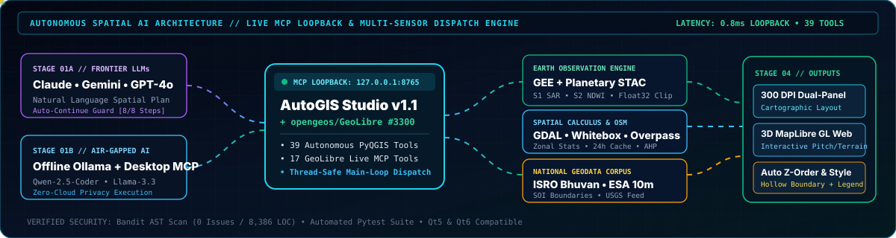
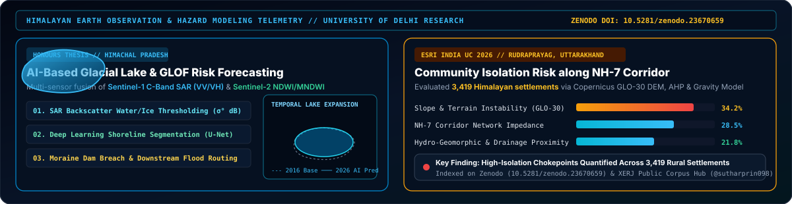
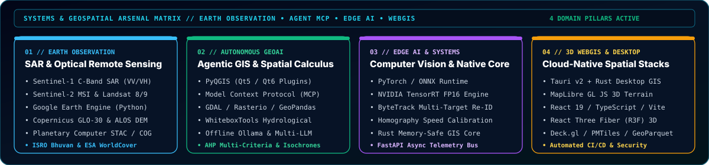

<!-- ==================== BESPOKE ANIMATED ORBITAL GEOAI COMMAND BANNER ==================== -->

 

<!-- ==================== LIVE VERIFIED CREDENTIAL & ECOSYSTEM BADGES ==================== -->

 

---

## 🛰️ Mission Brief & Executive Profile

I architect **autonomous geospatial AI agents**, **multi-sensor Earth Observation (SAR + Optical) hazard pipelines**, and **cloud-native spatial computing engines**. My work unifies quantitative physical geography, Multi-Criteria Decision Analysis (AHP), and live Model Context Protocol (MCP) bridges inside desktop and web GIS environments.

- 🏛️ **Academic Research Track:** **BA (Hons.) Geography with Research (4-Year Honours Track)** — *Department of Geography, University of Delhi (Dr. Bhim Rao Ambedkar College)* • **First Class Standing**
- 🧩 **Creator of [AutoGIS Studio (`v1.1.1`)](https://plugins.qgis.org/plugins/AutoGIS/):** Published on the **Official QGIS Plugin Repository (Plugin ID: `6782`)** — 39 autonomous spatial tools, Google Earth Engine integration, Live Loopback MCP Server (`127.0.0.1:8765`), Offline Local AI (Ollama), 300 DPI dual-panel publication layouts, and 3D MapLibre webmaps
- 🌍 **Core Open-Source Contributor ([`opengeos/GeoLibre`](https://github.com/opengeos/GeoLibre)):** Authored the **India National GIS Open Dataset Ecosystem** (`14` modules, `~1,400` LOC) and **[PR #3300](https://github.com/opengeos/GeoLibre/pull/3300)** adding `17` live desktop MCP control, WhiteboxTools, Model Builder, and viewport snapshot tools
- 🏔️ **Himalayan Cryosphere & Hazard Research:** Leading ongoing Honours Thesis on **AI-Based Glacial Lake Outburst Flood (GLOF) Risk Forecasting in Himachal Pradesh** using **Sentinel-1 C-Band SAR (VV/VH)**, **Sentinel-2 NDWI/MNDWI**, and Deep Learning shoreline segmentation; selected for **Esri India User Conference 2026** ([Zenodo DOI: `10.5281/zenodo.23670659`](https://doi.org/10.5281/zenodo.23670659))
- ⚡ **Industry & Systems Leadership:** **Founder & Chief Systems Architect** at **[CamAI](https://camai.princesite.in)** (TensorRT FP16 / ByteTrack edge vision platform) & **GIS Analyst** at **Carbon X Services Pvt. Ltd.** (Industrial Decarbonisation & Underground Carbon Capture and Storage `CCUS` spatial modeling)

---

## 🧠 Autonomous Spatial AI & Live MCP Pipeline

  

---

## 🏔️ Himalayan Earth Observation & Scientific Telemetry

  

---

## 🚀 Flagship Open-Source Systems, Research & Production Platforms

| System / Repository | Domain | Architecture & Live Credentials |
| :--- | :--- | :--- |
| **[AutoGIS Studio (`v1.1.1`)](https://github.com/sutharprin098/AutoGIS)** | **Official QGIS Plugin (`#6782`) & GeoAI Agent** | **39 autonomous PyQGIS tools**, Google Earth Engine (`ee-sutharprince098`) server-side polygon clipping, Planetary Computer STAC (`Float32` calculus), OpenStreetMap 24h smart cache, Live Loopback MCP Server (`127.0.0.1:8765`), Offline Ollama Local AI, 300 DPI dual-panel cartography, and 3D MapLibre GL exporter. 🔗 **[Official QGIS Repo (`#6782`)](https://plugins.qgis.org/plugins/AutoGIS/)** • **[Portal](https://autogis.princesite.in/)** • **[Direct Release ZIP](https://github.com/sutharprin098/AutoGIS/releases/latest)** |
| **[opengeos/GeoLibre](https://github.com/opengeos/GeoLibre/pull/3300)** | **Cloud-Native Desktop GIS (Tauri v2 + Rust)** | Core contributor to [`opengeos/GeoLibre`](https://github.com/opengeos/GeoLibre). Built the **India GIS Open Dataset Ecosystem** (ISRO Bhuvan, Survey of India, CWC, PMGSY) and **[PR #3300](https://github.com/opengeos/GeoLibre/pull/3300)** (`17` live desktop MCP bridge tools with `134/134` passing unit tests). 🔗 **[Upstream PR #3300](https://github.com/opengeos/GeoLibre/pull/3300)** • **[Fork Repository](https://github.com/sutharprin098/GeoLibre)** |
| **[NH-7 Himalayan Isolation Study](https://doi.org/10.5281/zenodo.23670659)** | **Published Research • Esri India UC 2026** | *Community Isolation Risk along the NH-7 Himalayan Transport Corridor (Rudraprayag, Uttarakhand)*. Evaluated **3,419 rural settlements** using Copernicus GLO-30 DEM, Analytic Hierarchy Process (AHP), and spatial gravity modeling. 🔗 **[Zenodo DOI: `10.5281/zenodo.23670659`](https://doi.org/10.5281/zenodo.23670659)** • **[XERJ Corpus Hub](https://hub.xerj.org/contributors/sutharprin098)** |
| **[CamAI Workstation](https://github.com/sutharprin098/camai-releases)** | **Edge-to-Cloud Computer Vision AI** | Enterprise real-time CCTV intelligence platform powered by **NVIDIA TensorRT FP16**, **ONNX Runtime**, **ByteTrack Re-ID**, homography vehicle speed estimation, FastAPI async telemetry, and Electron/TypeScript. 🔗 **[camai.princesite.in](https://camai.princesite.in)** |
| **[ShapeFixer](https://github.com/sutharprin098/ShapeFixer)** | **Browser-Native Spatial Topology Engine** | Zero-backend GIS topology repair, polygon self-intersection fixing, and attribute schema editor supporting Shapefiles, GeoJSON, GeoPackage, KML, and CSV datasets. |
| **[RustGIS](https://github.com/sutharprin098/RustGIS)** | **Memory-Safe Systems GIS Core** | High-throughput spatial geometry indexing, raster calculus, and vector processing engine engineered in pure **Rust**. |
| **[Map3D City Engine](https://github.com/sutharprin098/map3d)** | **Procedural 3D Urban Digital Twin** | Real-time 3D city renderer built with **React Three Fiber (R3F)** and WebGL, synthesizing OpenStreetMap building extrusions, road networks, and elevation meshes. |

---

## 🖥️ Live Workstation Showcase: AutoGIS Studio Inside QGIS Desktop

  
  

    
      <b>AutoGIS Studio (Official QGIS Plugin #6782)</b> executing a multi-step autonomous spatial plan inside QGIS Desktop — combining Google Earth Engine satellite composites, OpenStreetMap infrastructure vectors, automated cartographic Z-ordering, and 300 DPI publication layouts.
    
  

---

## 🛠️ Systems & Geospatial Arsenal Matrix

  

 

---

## 💼 Industry Consulting & Applied Spatial Engineering

- 🏭 **Carbon X Services Pvt. Ltd. (*GIS Analyst — Industrial Decarbonisation & CCUS*):** Engineered multi-layer spatial suitability models mapping industrial $\text{CO}_2$ point-source emitters against deep saline aquifers, basaltic formations, and pipeline transport corridors for underground Carbon Capture, Utilisation, and Storage (CCUS).
- ☀️ **Post-Mining Solar Reclamation & Utility Siting (*Independent Geospatial Consultant*):** Formulated custom **Composite Environmental Index (CEI)** and **Solar Potential Index (SPI)** rasters for degraded coal mine reclamation and utility-scale solar siting across Maharashtra (Pune) and central India.
- 🏥 **Urban Healthcare Accessibility & Isochrone Network Modeling (*Ludhiana*):** Built high-resolution road-network impedance graphs and emergency travel-time isochrones to quantify urban-periurban healthcare service gaps.

---

## 🐍 Autonomous Contribution Telemetry

  

---

## 📬 Direct Telemetry & Collaboration Channels

| Channel | Endpoint / Link | Purpose |
| :--- | :--- | :--- |
| 🌐 **Academic & Systems Portfolio** | **[princesite.in](https://www.princesite.in/)** | Complete Research, Publications & Systems Showcase |
| 🧩 **Official QGIS Plugin (`#6782`)** | **[plugins.qgis.org/plugins/AutoGIS](https://plugins.qgis.org/plugins/AutoGIS/)** | Install AutoGIS Studio directly in QGIS Plugin Manager |
| 🗺️ **AutoGIS Studio Documentation** | **[autogis.princesite.in](https://autogis.princesite.in/)** | Architecture, 39 Tool Reference & Live MCP Guide |
| 🎥 **CamAI Vision Platform** | **[camai.princesite.in](https://camai.princesite.in/)** | Edge-to-Cloud TensorRT CCTV Visual Intelligence |
| 🎓 **ORCID & Zenodo Research** | **[0009-0008-5483-2837](https://orcid.org/0009-0008-5483-2837)** • **[DOI: 10.5281/zenodo.23670659](https://doi.org/10.5281/zenodo.23670659)** | Peer-Reviewed Datasets, Preprints & Citations |
| 📧 **Primary Contact** | **[official.princesuthar@gmail.com](mailto:official.princesuthar@gmail.com)** • **[sutharprince098@gmail.com](mailto:sutharprince098@gmail.com)** | Erasmus / Research Collaborations & GeoAI Consulting |

