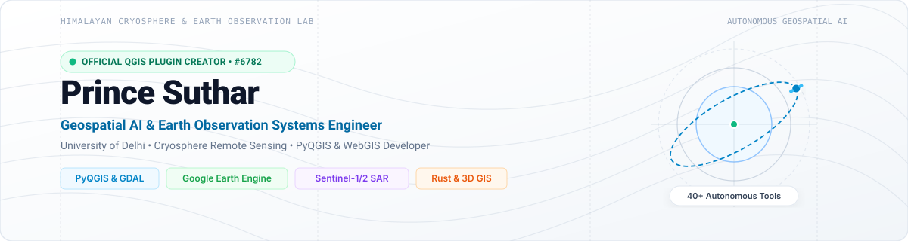

<!-- ==================== CLEAN LIGHT THEME HERO BANNER ==================== -->

  

<!-- ==================== VERIFIED CREDENTIALS & ECOSYSTEM BADGES ==================== -->

  
  
  
  
  
  
  

---

### 🛰️ About Me

I am a **Geospatial AI & Earth Observation Developer** and **Graduate Researcher in Geography & Remote Sensing at the University of Delhi**. 

My work bridges **satellite remote sensing, spatial AI agent architectures, and high-performance WebGIS systems**:

* 🧭 **Creator of [AutoGIS](https://plugins.qgis.org/plugins/AutoGIS/) (Official QGIS Plugin #6782):** Built an autonomous spatial AI studio and live MCP server native to QGIS Desktop, orchestrating Google Earth Engine, OpenStreetMap, raster zonal algebra, and AST-verified PyQGIS workflows across 40 autonomous tools.
* 🏔️ **Himalayan Cryosphere & GLOF Research:** Developed automated multi-temporal Sentinel-1 SAR and Sentinel-2 Optical pipelines for glacial lake expansion monitoring, bathymetric volume estimation, and downstream flood inundation modeling in the Western Himalayas.
* ⚡ **Systems & WebGIS Engineering:** Architecting zero-backend browser topology engines ([ShapeFixer](https://github.com/sutharprin098/ShapeFixer)), systems-level spatial geometry indexers in pure **Rust** ([RustGIS](https://github.com/sutharprin098/RustGIS)), and procedural 3D urban twins in WebGL ([Map3D](https://github.com/sutharprin098/map3d)).

---

### 🌟 Featured Systems & Open-Source Projects

| System / Repository | Domain | Architecture & Key Capabilities |
| :--- | :--- | :--- |
| **[AutoGIS](https://github.com/sutharprin098/AutoGIS)** [plugins.qgis.org/plugins/AutoGIS](https://plugins.qgis.org/plugins/AutoGIS/) | **Autonomous Geospatial AI & QGIS Studio** | Official QGIS Plugin (#6782) with 40 built-in autonomous tools, live FastMCP server bridge, Google Earth Engine integration, AST-aware code synthesis, and 100% offline local LLM (Ollama) execution. |
| **[Himalayan GLOF Early Warning](https://doi.org/10.5281/zenodo.23670659)** [DOI: 10.5281/zenodo.23670659](https://doi.org/10.5281/zenodo.23670659) | **Cryosphere Remote Sensing & Hazard Modeling** | Automated Sentinel-1 SAR backscatter thresholding + Sentinel-2 NDWI pipeline tracking glacial lakes across Himachal Pradesh with SRTM DEM flood routing. |
| **[ShapeFixer](https://github.com/sutharprin098/ShapeFixer)** | **Browser-Native Spatial Topology Engine** | Zero-backend client-side GIS topology repair, polygon self-intersection fixing, and schema editor supporting Shapefiles, GeoJSON, GeoPackage, KML, and CSV. |
| **[RustGIS](https://github.com/sutharprin098/RustGIS)** | **High-Performance Spatial Geometry Engine** | Memory-safe, high-throughput spatial indexing (R-Tree / BVH), raster algebra, and vector geometry processing engineered in pure **Rust**. |
| **[Map3D City Engine](https://github.com/sutharprin098/map3d)** | **Procedural 3D Urban Digital Twin** | Real-time 3D urban environment built with **React Three Fiber (R3F)** and WebGL, synthesizing OpenStreetMap building footprints, road graphs, and terrain meshes. |

---

### 🖥️ AutoGIS Studio in Action

  
  
<b>AutoGIS Studio (Official QGIS Plugin #6782)</b> executing an autonomous multi-step spatial pipeline inside QGIS Desktop — integrating Earth Engine satellite layers, OpenStreetMap infrastructure, and 300 DPI publication cartography.

---

### 🛠️ Technical Stack & Tooling

| Domain | Technologies & Frameworks |
| :--- | :--- |
| **Spatial & Remote Sensing** | `QGIS 3.22–3.34+` • `PyQGIS` • `Google Earth Engine (GEE)` • `GDAL / OGR` • `Rasterio` • `GeoPandas` • `Shapely` • `STAC API` |
| **Languages & Systems** | `Python 3.12` • `Rust` • `TypeScript` • `JavaScript` • `C++` • `SQL / PostGIS` |
| **WebGIS & 3D Graphics** | `MapLibre GL 3D` • `Leaflet` • `React 19` • `React Three Fiber (R3F)` • `WebGL` • `Tauri v2` |
| **AI, Protocols & Backends** | `Model Context Protocol (FastMCP)` • `Ollama (Local LLMs)` • `PyTorch` • `FastAPI` • `OpenCV` |

---

### 🔬 Applied Geospatial Research & Industry Projects

- 🛰️ **Himalayan Glacial Lake Outburst Flood (GLOF) Monitoring (*University of Delhi*):** Developed an end-to-end remote sensing methodology integrating Sentinel-1 Dual-Pol SAR backscatter with optical Sentinel-2 imagery and SRTM topography to monitor rapidly expanding proglacial lakes in the Satluj & Chenab basins.
- 🏭 **Industrial Decarbonisation & CCUS Suitability Modeling (*Carbon X Services*):** Engineered multi-criteria spatial suitability models mapping industrial $\text{CO}_2$ point-source emitters against deep saline aquifers, basaltic storage traps, and transport corridors for Carbon Capture, Utilisation, and Storage (CCUS).
- ☀️ **Post-Mining Solar Reclamation & Utility Siting:** Formulated **Composite Environmental Index (CEI)** and **Solar Potential Index (SPI)** rasters for degraded coal mine reclamation and utility-scale solar siting across central India.

---

### 📬 Connect With Me

 

Designed with clean light-mode aesthetics • Prince Suthar • Delhi, India

